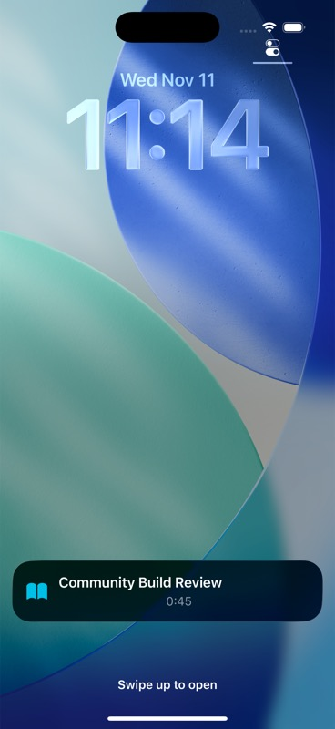

# Minutide

Minutide is a free, open-source iPhone time tracker maintained by [Elaren Studio](https://github.com/elaren-studio), continued from Liam Wittig's archived Stiint project. Create activities, start and stop them with iOS Shortcuts, review a day-by-day timeline, and explore time-use charts.

This repository is in community-revival work. It is source code for development and review; it does not announce an App Store release or a downloadable community build. The fork is independent and is not affiliated with or endorsed by the original author.

## What it does

- Create named activities with colors, icons, and optional weekday rules.
- Start, stop, query, and resume activities from the app or Shortcuts actions.
- Review and edit logged activity on a daily timeline.
- Explore time-use charts, including Sankey, pie, bar, line, and area diagrams.
- Show the current activity in an iOS Live Activity.
- Export activity logs as CSV.
- Optionally record start and end location for selected activities.
- Use all app features without a subscription or paid tier.

The project uses SwiftUI, SwiftData, App Intents, and Swift Package Manager. The current app deployment target is iOS 26.1. Check the Xcode project settings if you work from a later revision.

## Screenshot



This screenshot predates the Minutide rename. The original Stiint screenshots used in the Shortcuts setup guide also retain their original branding.

## Build and run in the iOS Simulator

You need Xcode with an iOS 26.1 SDK or newer. No Apple signing account is needed to build and run in the Simulator.

1. Open `Stiint.xcodeproj` in Xcode.
2. Allow Xcode to resolve the Swift packages listed in `Package.resolved`.
3. Select the `Stiint` scheme and an iOS Simulator destination.
4. Choose **Product → Run**.

The internal project, target, and scheme retain the name `Stiint` for source continuity. The installed app is **Minutide**, with bundle identifier `com.elaren.minutide` and Live Activity extension identifier `com.elaren.minutide.liveactivity`. The repository is [elaren-studio/minutide](https://github.com/elaren-studio/minutide). No signing team or Apple identifier registration is included in the source publication.

For a terminal build, first list available simulator destinations and then choose one by its identifier:

```sh
xcodebuild -resolvePackageDependencies -project Stiint.xcodeproj
xcodebuild -showdestinations -project Stiint.xcodeproj -scheme Stiint
xcodebuild build -project Stiint.xcodeproj -scheme Stiint \
  -destination 'generic/platform=iOS Simulator' CODE_SIGNING_ALLOWED=NO
```

To run the test scheme on a simulator, replace `SIMULATOR_ID` with an identifier printed by `-showdestinations`:

```sh
xcodebuild test -project Stiint.xcodeproj -scheme Stiint \
  -destination 'platform=iOS Simulator,id=SIMULATOR_ID' CODE_SIGNING_ALLOWED=NO
```

The same dynamic simulator selection and test command used by CI is available locally:

```sh
bash scripts/ci-ios.sh
```

For the canonical SSD checkout, project-local Xcode GUI DerivedData, and the difference between GUI and CLI build subfolders, see [Local Development](docs/LOCAL_DEVELOPMENT.md).

These are contributor instructions, not a claim that the current revision's final test run or hosted CI has passed. See [Device Acceptance](docs/DEVICE_ACCEPTANCE.md) for the manual checks and their current evidence.

### Install on your own iPhone

Physical-device installation requires signing with an Apple Developer team you control. In Xcode, select the app target, open **Signing & Capabilities**, choose your own Team, and let Xcode manage provisioning. If the community bundle identifier is unavailable to your team, use a unique personal identifier for local development and apply it consistently to the app and its extensions. Simulator use does not require signing. Do not use another person's signing credentials or provisioning profile.

## Privacy and data

Activity names and start/end times are stored in the app's on-device SwiftData store. Location is optional per activity; when enabled, the app can save precise latitude and longitude at activity start and end. CSV export includes activity names, timestamps, duration, and any saved coordinates. Treat exported files as sensitive and choose their destination deliberately.

The app stores records in an on-device SwiftData store with CloudKit disabled and has no project account or server-sync service. The acknowledgements screen loads the pinned dependency licenses bundled with the app; it does not need to fetch those notices from GitHub. App network traffic has not been independently audited. Shortcuts, iOS Location Services, and system share/export flows are controlled by Apple and by the choices you make on your device. This description summarizes the app source; it is not an independent privacy or security audit. See [SECURITY.md](SECURITY.md) for reporting guidance.

## Contributing and project status

Read [CONTRIBUTING.md](CONTRIBUTING.md) before opening a change. The current priorities and unfinished validation gates are in [docs/ROADMAP.md](docs/ROADMAP.md), with live handoff status in [docs/ACTIVE_CONTEXT.md](docs/ACTIVE_CONTEXT.md).

## Origin and license

This fork continues [Liam1506/Stiint](https://github.com/Liam1506/Stiint), based on upstream commit `a6f10f2d6637e9b3b330c56b818fb537357329b0`. The original app source remains under the MIT License; the copyright notice for Liam Wittig is preserved in [LICENSE](LICENSE). Third-party package details and bundled license resources are listed in [THIRD_PARTY_NOTICES.md](THIRD_PARTY_NOTICES.md).
